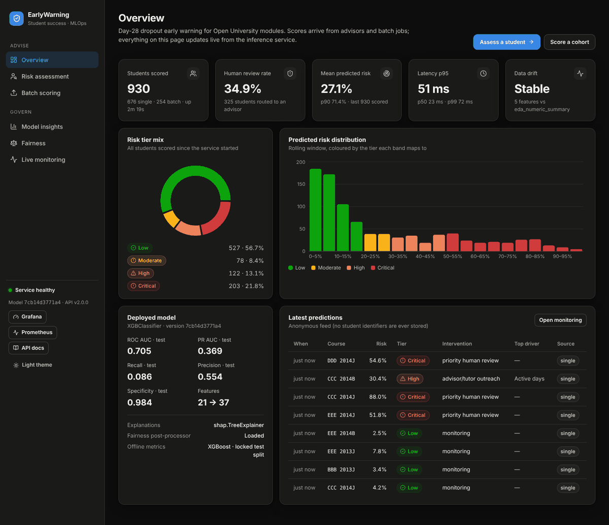
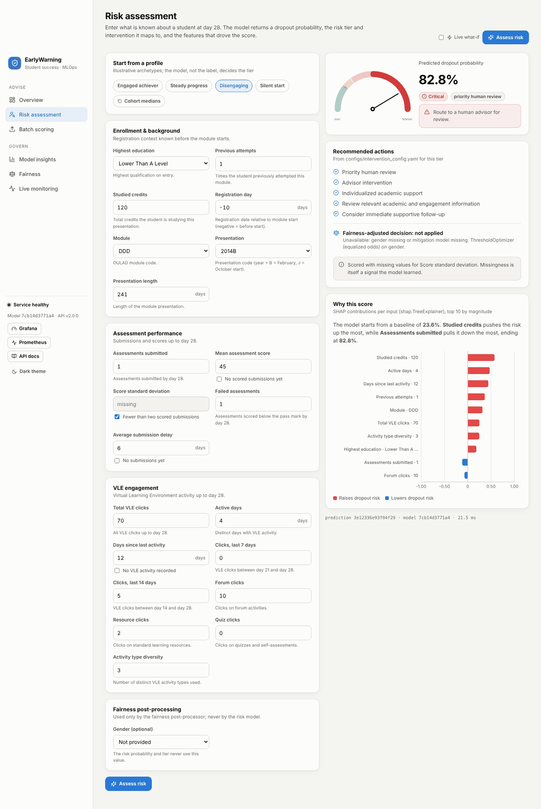
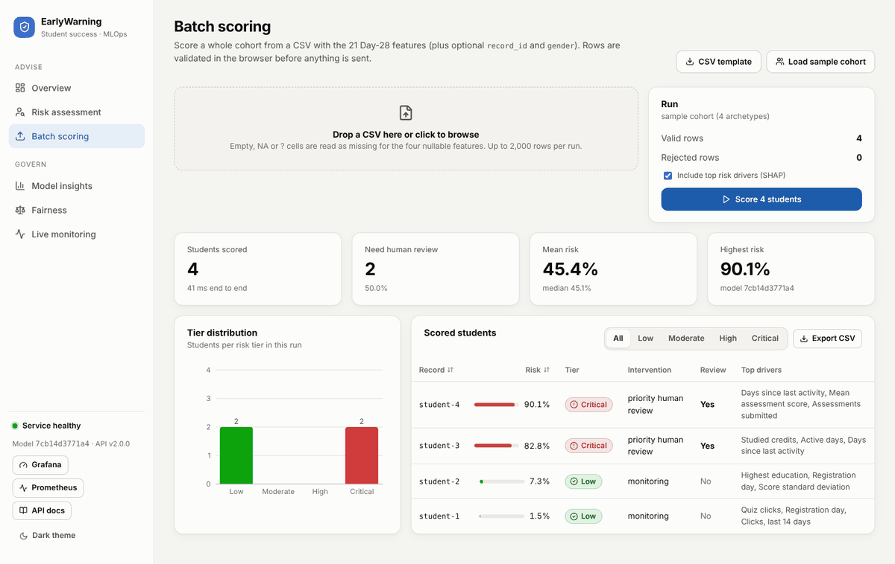
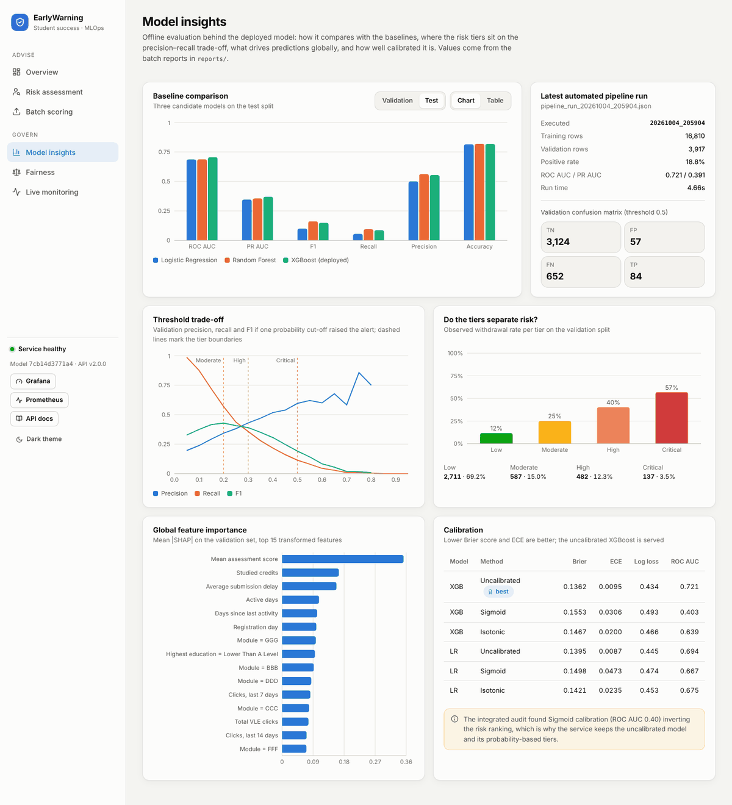
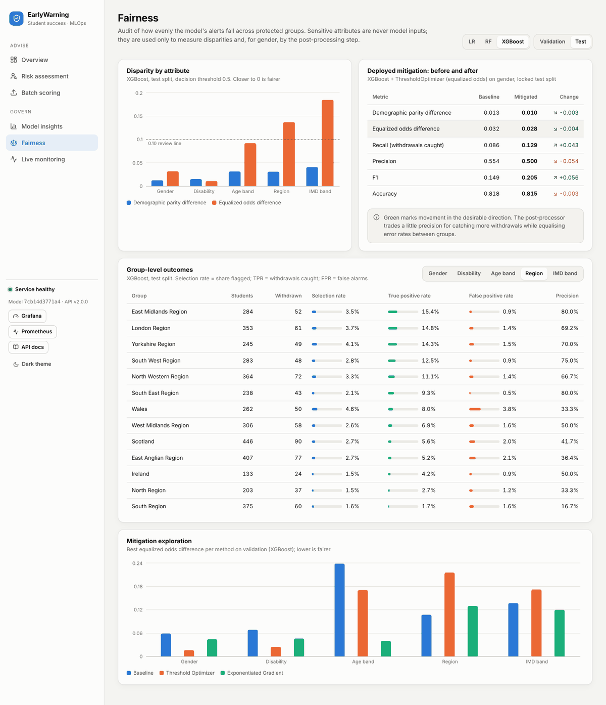
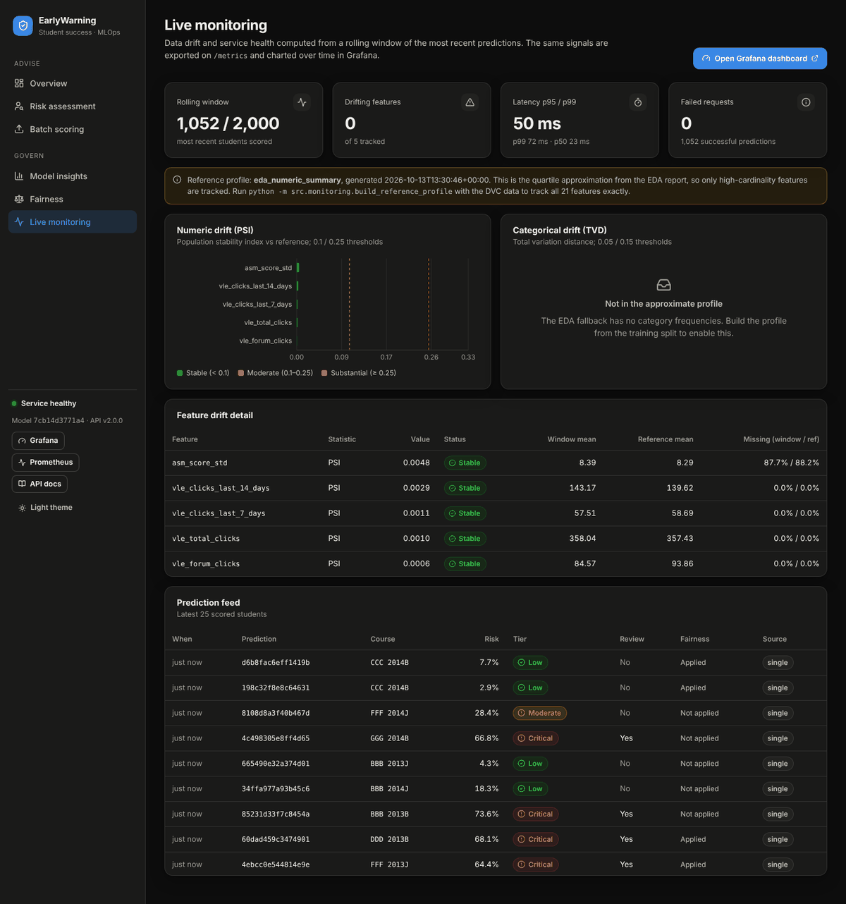
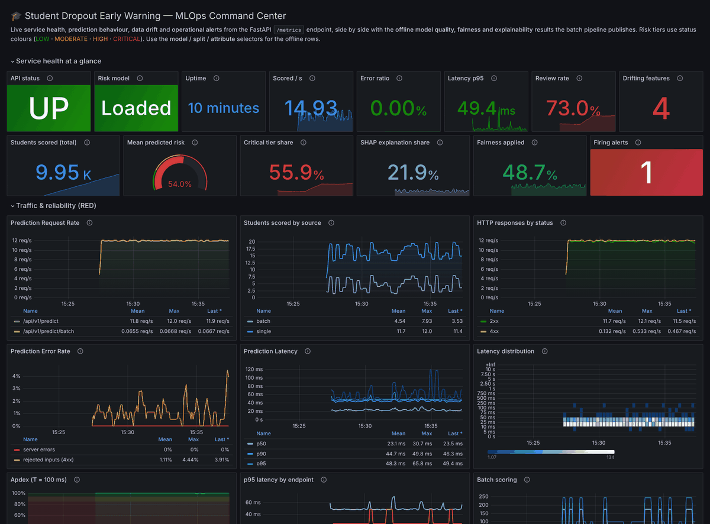
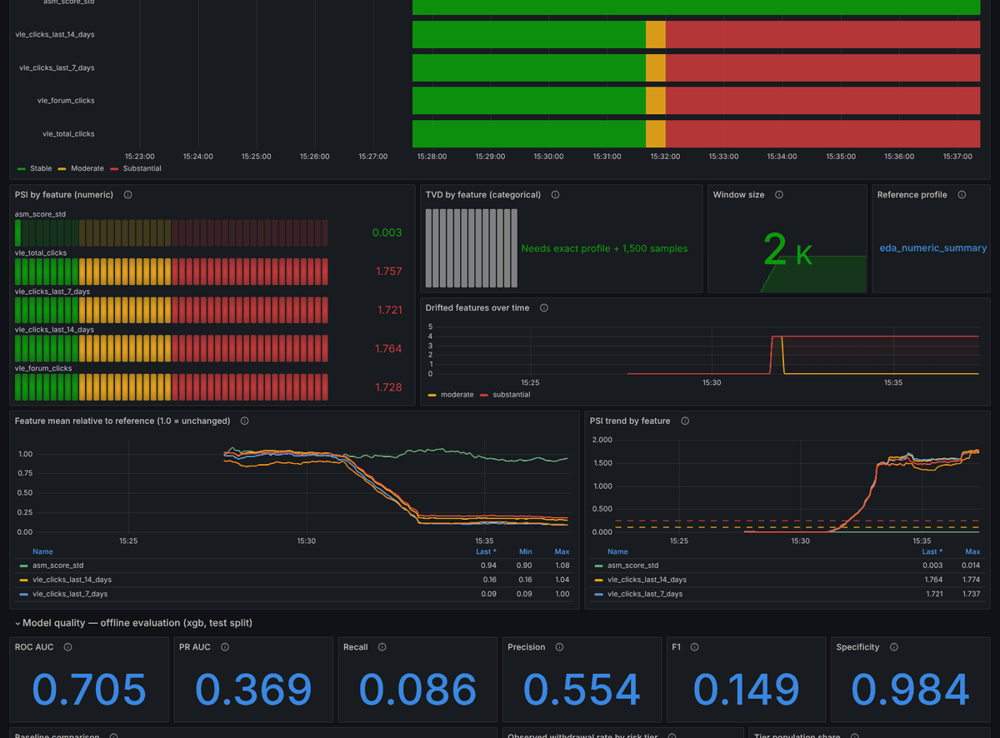
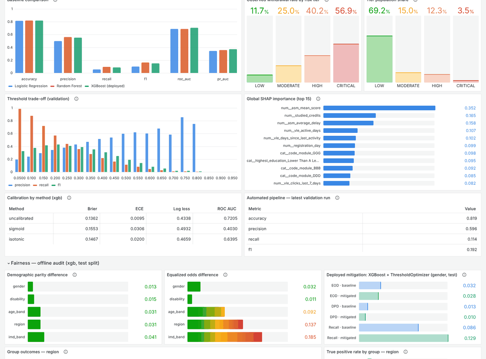

# Web Platform & Observability Upgrade: Reference

This document records what was added to the Student Dropout Early Warning project in the
"web platform and observability" upgrade, why each piece exists, how to run it, and how it
was verified. It is the companion to `docs/api_deployment.md` (Step 2.11/2.12) and
`docs/monitoring_and_drift.md` (Step 2.13), both of which still describe the original
contracts that remain in place.

---

## 1. Summary

| Area | Before | After |
|---|---|---|
| **User interface** | No UI in the repository | React + TypeScript console with 6 pages: overview, risk assessment with SHAP, CSV batch scoring, model insights, fairness audit, live monitoring |
| **Backend** | 4 endpoints (`/`, `/health`, `/metrics`, `/predict`) | Same 4 endpoints, unchanged contract, plus 15 versioned `/api/v1` endpoints (batch scoring, model card, feature schema, offline insights, live monitoring) |
| **Metrics** | 3 metrics (requests, errors, latency) | ≈ 2,000 series: RED per route, risk distribution, tier/intervention mix, fairness post-processing, explanation usage, data quality, **live drift (PSI/TVD)**, component health, plus the **offline evaluation results** (model quality, calibration, fairness, SHAP, pipeline runs) |
| **Grafana** | 3 panels | 66 panels in 7 rows across 11 visualization types, with template variables, annotations and links; generated from code |
| **Alerting** | 3 rules | 9 rules (adds model not loaded, input rejection, substantial drift, risk shift, review surge, explainer down) |
| **Deployment** | API image could neither build nor start (see §9); monitoring-only compose | Working API image, web image (nginx), full-stack `docker-compose.yml`, optional traffic simulator |
| **Tests** | 137 project tests | 46 new tests (API v1, live monitoring, dashboard/alerts); CI also builds the UI and checks the dashboard is regenerated |

> **About Streamlit.** No Streamlit code exists anywhere in the repository or its git history
> (`git log --all` was searched). If a `streamlit_app.py` exists on your machine it was never
> committed; it can simply be deleted. The React console replaces it.

---

## 2. Architecture

```
                         ┌──────────────────────────────┐
  Browser ──────────────▶│ web  (nginx, :8080)          │  static React build
                         │   /api/* ──────────────┐     │
                         └────────────────────────┼─────┘
                                                  ▼
                         ┌──────────────────────────────────────────────┐
  Batch jobs / clients ─▶│ api  (FastAPI, :8000)                        │
                         │  /predict  /api/v1/*  /metrics               │
                         │  InferenceService ─ XGBoost pipeline         │
                         │                   ─ InterventionEngine       │
                         │                   ─ ThresholdOptimizer (opt) │
                         │                   ─ SHAP explainer (opt)     │
                         │  LiveMonitor ─ rolling window → drift, stats │
                         │  ReportStore ─ reports/*.csv|json            │
                         └───────────────┬──────────────────────────────┘
                                         │ scrape every 5 s
                         ┌───────────────▼───────────┐     ┌──────────────────────┐
                         │ prometheus (:9090)        │────▶│ grafana (:3000)      │
                         │  alerts.yml (9 rules)     │     │  provisioned board   │
                         └───────────────────────────┘     └──────────────────────┘
  traffic (optional, profile "demo") ─▶ api   synthetic, statistically realistic load
```

Design choices:

* **One origin for the UI.** The browser only ever calls `/api/v1/*` on the origin it was
  served from. nginx (Docker), the Vite dev server (proxy) and FastAPI itself (`/ui`) all
  satisfy that, so the same build runs in every mode without CORS configuration.
* **Monitoring never sits on the request path.** Drift and window statistics are computed
  lazily when Prometheus scrapes or the UI asks (cached per window version), not per request.
* **Optional components fail independently.** A missing fairness model or an incompatible
  SHAP install degrades that feature and is reported in `/api/v1/health`; scoring keeps working.

---

## 3. Running it

### 3.1 Full stack in Docker

```bash
ls models/baseline/xgb_pipeline.pkl         # served model must exist (dvc pull / training pipeline)
docker compose up -d --build                # api :8000, web :8080, prometheus :9090, grafana :3000
docker compose --profile demo up -d --build # + traffic simulator (normal 15 min → engagement drop 10 min → normal)
docker compose down                         # stop (named volumes keep Prometheus/Grafana data)
```

The API image bakes in `models/baseline/xgb_pipeline.pkl` and, if present,
`models/mitigated/xgb_threshold_optimizer_gender.pkl` (`.dockerignore` excludes all other
model files). `reports/` is mounted read-only, so re-running a batch evaluation updates the
UI and Grafana without rebuilding.

### 3.2 Local development

```bash
pip install -r requirements-api.txt
uvicorn src.api.main:app --reload --port 8000

cd frontend
npm install
npm run dev                                  # http://localhost:5173, proxies /api → :8000

docker compose -f docker-compose.monitoring.yml up -d   # Prometheus + Grafana scraping host.docker.internal:8000
python scripts/simulate_traffic.py --rps 5               # optional live traffic
```

### 3.3 Single process

```bash
cd frontend && npm run build && cd ..
uvicorn src.api.main:app --port 8000        # UI at http://localhost:8000/ui/
```

### 3.4 Exact drift reference (recommended once)

```bash
python -m src.monitoring.build_reference_profile   # reads data/processed/splits/development_train.parquet
```

This rewrites `configs/drift_reference_profile.json` with decile bins for all 18 numeric
features and category frequencies for the 3 categorical ones. The committed file is an
approximation built from `reports/eda/numeric_summary.csv` (see §5.3); restart the API after
rebuilding the profile.

---

## 4. Backend (FastAPI)

### 4.1 Endpoints

Legacy endpoints keep their exact request/response contract (all original tests pass):

| Method | Path | Purpose |
|---|---|---|
| GET | `/` | Service banner (now also reports `docs` and `ui` paths) |
| GET | `/health` | `{status, model_loaded}` |
| GET | `/metrics` | Prometheus exposition |
| POST | `/predict?include_explanation=` | Single prediction, legacy response model |

New versioned endpoints (`src/api/routers/`):

| Method | Path | Purpose |
|---|---|---|
| GET | `/api/v1/health` | Status, uptime, model version, per-component health and detail |
| GET | `/api/v1/meta` | Service name/version and links (Grafana, Prometheus, docs) |
| GET | `/api/v1/model` | Model card: artifact SHA-256/size/mtime, estimator, hyper-parameters, tier thresholds, intervention rules, offline test/validation metrics |
| GET | `/api/v1/schema` | Feature catalog (labels, groups, ranges, defaults, nullability), course catalog, 4 sample profiles |
| POST | `/api/v1/predict?include_explanation=true` | Legacy fields + `prediction_id`, `model_version`, `latency_ms`, `missing_features`, full per-feature SHAP explanation |
| POST | `/api/v1/predict/batch` | Up to 2,000 students per call, optional top-3 drivers per row, cohort summary |
| GET | `/api/v1/insights/models` | Baseline comparison, calibration, calibration audit, threshold sweeps, integrated summary |
| GET | `/api/v1/insights/explainability` | Global SHAP and XGBoost gain importance with readable labels |
| GET | `/api/v1/insights/fairness` | Disparity summary, per-group metrics, mitigation results, fairness compatibility |
| GET | `/api/v1/insights/interventions` | Validation outcomes per tier, intervention mapping, thresholds |
| GET | `/api/v1/insights/pipeline` | Automated pipeline run reports |
| GET | `/api/v1/monitoring/summary` | Totals, rolling-window statistics, latency quantiles, drift status |
| GET | `/api/v1/monitoring/drift` | Per-feature drift statistics, thresholds, reference profile metadata |
| GET | `/api/v1/monitoring/recent?limit=` | Anonymous feed of recent predictions (no inputs, no identifiers) |

Interactive documentation: `http://localhost:8000/docs`.

### 4.2 Schema change: genuinely missing values

`asm_mean_score`, `asm_score_std`, `asm_average_delay` and `vle_days_since_last_activity`
are now `Optional[float]` but still **required keys** (`Field(...)`): a client must send
them, and may send `null`. Previously a student with no scored submission could not be
represented, although the model's most important feature
(`missingindicator_asm_mean_score`, XGBoost gain 0.186) is exactly that missingness. The
pipeline's `SimpleImputer(add_indicator=True)` handles the nulls as it did in training.
All other features still reject `null` (HTTP 422).

### 4.3 Explanations

`src/api/explain.py` computes path-dependent TreeSHAP in log-odds space with one of two
interchangeable backends:

1. `shap.TreeExplainer` through the project's `SHAPExplainer` (preferred), or
2. XGBoost's built-in `pred_contribs=True` when the installed `shap` cannot parse the
   XGBoost 3 `base_score` (the problem the Dockerfile patches).

Both were compared on the same model: maximum absolute difference **0.0**, and
`sigmoid(base + Σ contributions)` reproduces `predict_proba` to 6·10⁻⁸. The v1 response
sums one-hot columns back to the 21 raw features, so the UI explains "Module = DDD" as one
bar. The active backend is visible in `/api/v1/health` and in Grafana.

### 4.4 Other behaviour

* **Fairness post-processing** uses `ThresholdOptimizer.predict(..., random_state=42)`.
  The optimizer is randomised, so decisions were previously non-reproducible.
* **Batch scoring** is vectorised: one `predict_proba` and at most one ThresholdOptimizer call per batch.
* **Settings** (`src/api/settings.py`) come from `configs/monitoring_config.yaml` (`monitoring.live`)
  with environment overrides: `MODEL_PATH`, `MITIGATION_MODEL_PATH`, `REPORTS_DIR`,
  `REFERENCE_PROFILE_PATH`, `DRIFT_WINDOW_SIZE`, `DRIFT_MIN_SAMPLES`,
  `DRIFT_MIN_SAMPLES_CATEGORICAL`, `MAX_BATCH_SIZE`, `GRAFANA_URL`, `PROMETHEUS_URL`,
  `CORS_ORIGINS`, `UI_DIST_DIR`.
* **Privacy**: logs carry method/path/status/latency only; the monitoring window keeps raw
  inputs in memory for drift but never returns them; the recent feed exposes only outputs
  plus module/presentation codes.

---

## 5. Monitoring

### 5.1 Prometheus metrics catalog

Original (names unchanged, alert rules depend on them):
`student_dropout_prediction_requests_total`, `student_dropout_prediction_errors_total`,
`student_dropout_prediction_latency_seconds`.

Live serving metrics (`src/monitoring/application_metrics.py`):

| Metric | Type | Labels |
|---|---|---|
| `student_dropout_http_requests_total` | counter | method, route (template), status |
| `student_dropout_http_request_duration_seconds` | histogram | method, route |
| `student_dropout_http_requests_in_progress` | gauge | |
| `student_dropout_predictions_total` | counter | risk_tier, source (single, batch) |
| `student_dropout_interventions_total` | counter | intervention_level |
| `student_dropout_human_review_required_total` | counter | |
| `student_dropout_risk_probability` | histogram (5 % buckets) | |
| `student_dropout_fairness_decisions_total` | counter | status, decision |
| `student_dropout_explanations_total` / `_explanation_latency_seconds` | counter / histogram | backend |
| `student_dropout_batch_requests_total`, `_batch_size`, `_batch_latency_seconds` | counter / histograms | |
| `student_dropout_missing_feature_values_total` | counter | feature |
| `student_dropout_model_loaded`, `student_dropout_component_up` | gauges | component |
| `student_dropout_model_info` | info | version, estimator, explainer_backend, fairness_mitigator, reference_profile |
| `student_dropout_app_start_time_seconds` | gauge | |

Rolling-window metrics (`src/monitoring/live_monitor.py`, computed at scrape time):
`student_dropout_window_predictions`, `_window_mean_risk`, `_window_review_rate`,
`_window_tier_share{risk_tier}`, `_feature_drift_score{feature,metric}`,
`_feature_drift_status{feature}` (0/1/2), `_drifted_features{severity}`,
`_feature_window_mean`, `_feature_reference_mean`, `_feature_window_missing_rate`,
`_reference_profile_info{source}`.

Offline evaluation metrics (`src/monitoring/offline_metrics.py`, read from `reports/` at scrape time):
`student_dropout_offline_model_metric{model,split,metric}`, `_calibration_metric`,
`_risk_tier_metric`, `_threshold_sweep`, `_shap_importance`, `_fairness_disparity`,
`_group_metric`, `_mitigation_metric`, `_pipeline_validation_metric`, `_pipeline_runs`.

Label values are bounded enums. Prometheus' own `/metrics` scrapes are excluded from the
HTTP metrics so they do not drown the traffic panels.

### 5.2 Live drift method

* The window holds the last **2,000** scored students (single and batch).
* **Numeric features:** PSI against reference bins, with missing values as their own bin.
  The bins are deciles of the training split and their reference shares are computed on the
  data, so tied and discrete values are exact. Zero shares are substituted with 1e-4, as in
  `drift_detector.calculate_psi`.
* **Categorical features:** total variation distance against reference frequencies.
* **Thresholds:** those in `monitoring_config.yaml` (PSI 0.10/0.25, TVD 0.05/0.15).
* **Warm-up sizes come from the sampling noise of each statistic.** E[PSI | no drift] ≈ (bins−1)/n,
  so numeric drift is reported from **500** samples. In 20 simulated windows of 500 reference-like
  students, the worst of 18 features stayed below 0.06. E[TVD | no drift] ≈ 0.4·Σ√(p(1−p))/√n,
  which is about 0.043 for the 7 modules at n = 500, uncomfortably close to the 0.05 threshold.
  Categorical drift therefore waits for **1,500** samples (≈ 0.025).

### 5.3 Reference profile

| Source | Features | When |
|---|---|---|
| `development_train` (exact deciles + category frequencies) | 18 numeric + 3 categorical | After `python -m src.monitoring.build_reference_profile` with the DVC data |
| `eda_numeric_summary` (committed default) | 5 numeric: `vle_total_clicks`, `vle_clicks_last_7_days`, `vle_clicks_last_14_days`, `vle_forum_clicks`, `asm_score_std` | Out of the box |

The fallback only knows min/25/50/75/95 %/max. Assuming 25/25/25/20/5 % bin shares is
safe only when no single value carries much mass at a bin edge, so it keeps features whose
quantiles are strictly increasing and that have at least 500 distinct values. The UI and
Grafana label the profile so nobody mistakes the approximation for the real thing.

### 5.4 Alert rules (`monitoring/prometheus/alerts.yml`)

| Alert | Severity | Condition |
|---|---|---|
| HighErrorRate | critical | > 10 % of prediction requests failing for 1 m |
| HighLatency | warning | p95 latency > 1 s for 1 m |
| InstanceDown | critical | scrape target down for 1 m |
| ModelNotLoaded | critical | API up but the risk model is not loaded for 1 m |
| HighInputRejectionRate | warning | > 20 % of prediction requests rejected (4xx) for 5 m |
| SubstantialFeatureDrift | warning | any feature at PSI ≥ 0.25 / TVD ≥ 0.15 for 5 m |
| RiskScoreShift | warning | window mean risk > 0.35 (validation ≈ 0.18) with ≥ 500 samples, 10 m |
| HumanReviewSurge | warning | review share > 35 % (validation ≈ 16 %) with ≥ 500 samples, 10 m |
| ExplainerUnavailable | warning | SHAP engine down for 5 m |

All rules and both Prometheus configs pass `promtool check`.

---

## 6. Grafana dashboard: "Student Dropout EWS · MLOps Command Center"

Provisioned automatically (uid `mlops-monitoring`, folder "MLOps", set as the Grafana home
dashboard). It is generated by `monitoring/grafana/build_dashboard.py`; edit the generator,
run it, and commit both files. A test fails if they diverge.

**Variables:** data source, job, instance (live rows); offline model, split, sensitive
attribute (offline rows). **Annotations:** API restarts and firing alerts. **Links:** web
UI, API docs, Prometheus alerts. Shared crosshair, 10 s refresh.

| Row | Panels |
|---|---|
| Service health at a glance | API status · Risk model · Uptime · Scored/s · Error ratio · Latency p95 · Review rate · Drifting features · Students scored (total) · Mean predicted risk gauge · Critical tier share · SHAP explanation share · Fairness applied · Firing alerts |
| Traffic & reliability (RED) | Prediction Request Rate · Students scored by source · HTTP responses by status · Prediction Error Rate · Prediction Latency (p50/90/95/99) · Latency distribution heatmap · Apdex · p95 latency by endpoint · Batch scoring |
| Prediction analytics | Risk tier mix · Students scored by risk tier (stacked bars) · Risk score distribution heatmap · Risk score quantiles vs tier cut-offs · Recommended interventions · Human review inflow · Fairness post-processing outcomes · Fairness-adjusted flag rate · Null inputs by feature |
| Data drift | Drift status by feature (state timeline) · PSI by feature · TVD by feature · Window size · Reference profile · Drifted features over time · Feature mean relative to reference (indexed to 1.0) · PSI trend by feature (with 0.10 / 0.25 lines) |
| Model quality (offline) | ROC AUC · PR AUC · Recall · Precision · F1 · Specificity · Baseline comparison · Observed withdrawal rate by tier · Tier population share · Threshold trade-off · Global SHAP importance · Calibration by method · Latest pipeline run |
| Fairness (offline) | Demographic parity difference · Equalized odds difference · Deployed mitigation before/after · Group outcomes table · True positive rate by group |
| Runtime, components & alerts | Serving components (state timeline) · Served model · CPU · Memory · Requests in flight · Python GC · Firing alerts table |

Colour conventions match the web UI. Risk tiers and drift states use status colours, and
models use fixed categorical colours (LR blue, RF orange, XGBoost aqua). Ordered latency
quantiles use one blue ramp, and different units never share an axis: the mean-versus-reference
view is indexed to 1.0 rather than plotting raw means of different scales together.

---

## 7. Web UI (`frontend/`)

Stack: React 18.3, TypeScript 5.9 (strict), Vite 5.4, Recharts 3.8, lucide-react icons.
There is no UI framework dependency: the design system lives in `src/index.css` (CSS tokens,
light and dark themes that follow the OS with a manual toggle, responsive down to phone width).

| Page | What it does |
|---|---|
| **Overview** (`#/`) | Live KPIs (students scored, review rate, mean risk, p95 latency, drift state), tier mix donut, risk histogram coloured by tier, deployed-model card, anonymous prediction feed. Polls every 5 s. |
| **Risk assessment** (`#/assess`) | 21-feature form in three groups with units, ranges, nullable toggles, course-aware presentation and length auto-fill, consistency warnings, 4 archetype presets, optional gender for the fairness post-processor. The result shows a risk gauge with tier bands, tier badge, intervention, review flag, recommended actions, fairness decision, missing-value note and a diverging SHAP chart with a plain-language summary. **Live what-if** re-scores 450 ms after each edit. |
| **Batch scoring** (`#/batch`) | Drag-and-drop CSV (RFC 4180 parser, validated in the browser before upload), downloadable template, sample cohort, optional SHAP drivers, summary tiles, tier distribution, sortable/filterable table, CSV export. |
| **Model insights** (`#/insights`) | Baseline comparison (chart ↔ table), latest pipeline run with confusion matrix, threshold trade-off with tier boundaries, observed withdrawal rate per tier, global SHAP importance, calibration table with the ranking-inversion warning derived from the audit. |
| **Fairness** (`#/fairness`) | Model/split selectors, disparity by attribute, deployed mitigation before/after with coloured deltas, group-level table (selection rate, TPR, FPR, precision) with small-group warnings, mitigation exploration. |
| **Live monitoring** (`#/monitoring`) | Window fill, drifting features, latency, failures, reference-profile notice, PSI/TVD charts against thresholds, per-feature drift table, prediction feed, link to Grafana. |

Charts follow a validated palette (all-pairs colour-vision-deficiency checks pass in both
themes). Tiers always carry icon and label, never colour alone, and tooltips enhance values
rather than gate them.

---

## 8. Traffic simulator (`scripts/simulate_traffic.py`)

Standard library only. Students are drawn from a Gaussian copula: one latent engagement
factor per student, each feature from its reference marginal, nested click counters kept
consistent, module/presentation drawn from an IPF-fitted joint over the 22 real courses, and
missingness structural (no submissions ⇒ no score).

| Scenario | Effect | Measured (500 students) |
|---|---|---|
| `normal` | reference-like | worst PSI 0.02–0.07 (stable) |
| `engagement-drop` | VLE activity −1.4 SD | PSI 1.7–2.5 on click/activity features |
| `assessment-shock` | scores −1.2 SD, more failures | PSI ≈ 1.0 on `asm_mean_score` (needs the exact profile) |

```bash
python scripts/simulate_traffic.py --rps 8 --schedule normal:300,engagement-drop:300,normal
```

About 30 % of requests ask for SHAP, 60 % carry gender, 1 % are deliberately invalid (to
exercise the 4xx panels), and a batch of 20–120 students goes out every 30 s.

---

## 9. Defects found in the existing code and fixed

| # | Defect | Impact | Fix |
|---|---|---|---|
| 1 | All artifacts loaded in one `try`; the SHAP explainer fails on XGBoost 3 `base_score` outside Docker | Whole service reported `model_loaded: false`; every `/predict` failed | Components load independently; native TreeSHAP fallback (§4.3) |
| 2 | Dockerfile did not install `prometheus_client` and did not copy `src/monitoring` or `src/data` | API container crashed on import | Pinned `prometheus-client==0.26.0`; copy all of `src/` |
| 3 | `shap_explainer.py` imported `matplotlib` and `mlflow` without using them | Container crash (neither in the API image) | Removed the unused imports |
| 4 | `fairlearn` missing from API requirements | ThresholdOptimizer could not be unpickled in the container | Pinned `fairlearn==0.14.0` |
| 5 | Grafana datasource had no `uid`, dashboard referenced `uid: prometheus` | Panels could not resolve the datasource | Provisioned `uid: prometheus`; dashboard uses a datasource variable |
| 6 | `HTTPException(503)` caught by a blanket `except Exception` | Clients saw 500 "503: Model is not loaded" | HTTP errors pass through unchanged |
| 7 | ThresholdOptimizer prediction not seeded | Same student could get different fairness decisions | `random_state=42` |
| 8 | Nullable features not representable (§4.2) | Students without submissions could not be scored faithfully | Required-but-nullable fields |
| 9 | The Dockerfile's multi-line SHAP patch joined into one line with `;with open(...)`, a Python `SyntaxError` | `docker build` always failed at that step | Rewritten as a single `pathlib` expression that reports how many locations it patched |

---

## 10. Verification performed

| Check | Result |
|---|---|
| Full test suite (Python 3.10, pinned requirements, SHAP patched as in Docker) | **170 passed**, 11 skipped (data-dependent, unchanged), 0 failed |
| New tests without any model artifacts (CI path, tiny model trained in-test) | 39 / 39 passed |
| Pre-existing environment failures, compared on the untouched original commit | `test_mlflow_tracking` (2, read-only SQLite) and `test_explainability` without the SHAP patch (7) fail identically before and after |
| SHAP backends | identical values (max diff 0.0); additivity error 6·10⁻⁸ |
| Frontend | `tsc` strict: 0 errors; production build OK; Playwright run of every page in light and dark mode at 1440 px and 390 px: 0 console errors, no horizontal overflow |
| Prometheus | `promtool check rules` (9 rules) and `check config` (both configs) pass |
| Grafana | dashboard JSON regenerated and tested: unique ids, no overlapping panels, every PromQL metric exported by the service |
| Docker | API and web images built; full 5-container stack (`--profile demo`) healthy; dashboard rendered in Grafana 11.2.2 (see §10.1) |

All runs used a **schema-faithful stand-in model**: the repository's own preprocessor and
XGBoost hyper-parameters trained on synthetic data. The real artifacts are DVC/gitignored and
the OULAD download hosts are not reachable from the build environment. Nothing about the
stand-in is committed. With your real `models/` directory the numbers in the UI and Grafana
are your model's.

### 10.1 End-to-end runs

**Full Docker stack** (`docker compose --profile demo up -d`):

* `api` healthy (container health check). All four components loaded, with
  `explainer = shap.TreeExplainer` because the fixed patch works. The image holds exactly the
  two model files, 31 report CSVs, no figures, and runs as non-root `apiuser`.
* `web` serves the UI and proxies `/api` and `/docs` to `api`. Every page loaded in Chromium
  with no console errors. The risk assessment returned the same probability and contributions
  as the host run that used the native TreeSHAP backend.
* `prometheus` scrapes `api:8000` (`up`); all 9 rules load with health `ok`.
* `grafana` provisions the datasource (uid `prometheus`) and the dashboard (folder "MLOps",
  home dashboard). All 66 panels render with zero panel errors.

**Drift detection, end to end** (host API, `docker-compose.monitoring.yml`, simulator schedule
`normal:240,engagement-drop:600` at 12 req/s):

| Phase | What happened |
|---|---|
| normal | Window filled to 2,000; all tracked features stable (PSI ≤ 0.005); window means within a few % of the reference |
| engagement drop starts | The state timeline turned amber, then red, as the window rolled; PSI rose to 1.7–1.8 on the four click features while `asm_score_std` (not shifted) stayed at 0.003 |
| + 5 min | `SubstantialFeatureDrift` went *pending → firing*; `RiskScoreShift` and `HumanReviewSurge` were pending (10 min `for:`); KPI strip showed 4 drifting features and 1 firing alert, and the firing-alerts table listed the alert |

### 10.2 Screenshots

Live numbers come from the stand-in model and simulated traffic; offline panels show the real
values from `reports/`.

| | |
|---|---|
|  **Overview** (dark theme) |  **Risk assessment with SHAP** |
|  **Batch scoring** |  **Model insights** |
|  **Fairness audit** |  **Live monitoring** |


*Grafana: KPI strip and traffic/reliability row during the engagement-drop scenario (1 alert firing).*


*Grafana: drift row. The state timeline flips from Stable to Substantial, PSI crosses its 0.10 / 0.25 lines, and the indexed means fall.*


*Grafana: offline model quality, explainability and fairness rows (light theme).*

---

## 11. File map

```
src/api/
  main.py              legacy endpoints, middleware (HTTP metrics), routers, /ui mount
  inference.py         InferenceService (independent component loading, vectorised scoring, reload)
  explain.py           SHAP engine with native fallback, per-feature aggregation
  feature_catalog.py   labels/ranges/defaults, course catalog, sample profiles
  schemas.py           v1 response/batch models (+ nullable features)
  settings.py          config + environment overrides
  telemetry.py         metrics + live monitor wiring
  routers/             system.py, predict.py, insights.py, monitoring.py
src/monitoring/
  application_metrics.py   Prometheus metric definitions
  live_monitor.py          rolling window, PSI/TVD drift, Prometheus collector
  offline_metrics.py       offline evaluation → Prometheus gauges
  report_store.py          cached, JSON-safe access to reports/
  build_reference_profile.py
configs/drift_reference_profile.json, configs/monitoring_config.yaml (monitoring.live)
frontend/                  React app, Dockerfile (node build → nginx), nginx.conf
monitoring/grafana/build_dashboard.py, dashboards/prediction_dashboard.json, provisioning/
monitoring/prometheus/alerts.yml, prometheus.yml (host API), prometheus.docker.yml (compose)
scripts/simulate_traffic.py
docker-compose.yml (full stack), docker-compose.monitoring.yml (monitoring only)
tests/test_api_v1.py, test_live_monitoring.py, test_grafana_dashboard.py, _tiny_model.py
```

---

## 12. Known limitations

* **In-process state.** Live-window statistics reset when the API restarts and are
  per-process. Run uvicorn with one worker (the default here) or move the window to a shared
  store before scaling out. Prometheus counters are unaffected.
* **Approximate default drift profile.** Build the exact profile (§3.4) to monitor all 21 features.
* **CI and DVC artifacts.** The original API, explainability and data tests need the
  DVC-tracked data and models, which CI does not have. The new tests fall back to a tiny model
  so they run anywhere.
* **Grafana credentials.** `admin/admin` with anonymous viewer access suits a local
  demonstration only. Change `GF_SECURITY_ADMIN_PASSWORD` before exposing it.
* **No Alertmanager.** Alerts are evaluated and visible in Prometheus and Grafana; wiring
  email/Slack notifications needs an Alertmanager service.
* **API image size (≈ 3.3 GB).** On Linux, `xgboost==3.2.0` pulls in the CUDA NCCL library and
  `shap` pulls in numba/llvmlite. Switching to the `xgboost-cpu` package would shrink the image
  considerably, but it changes a pinned training dependency, so it was left as a decision for you.
